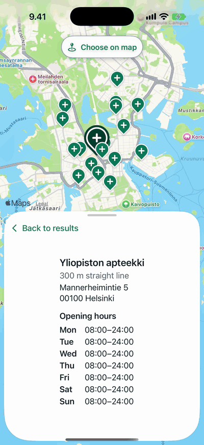
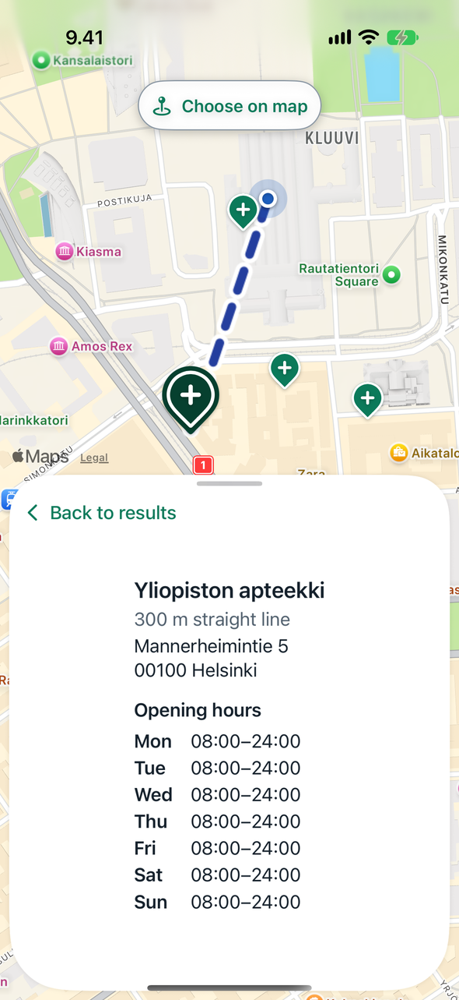
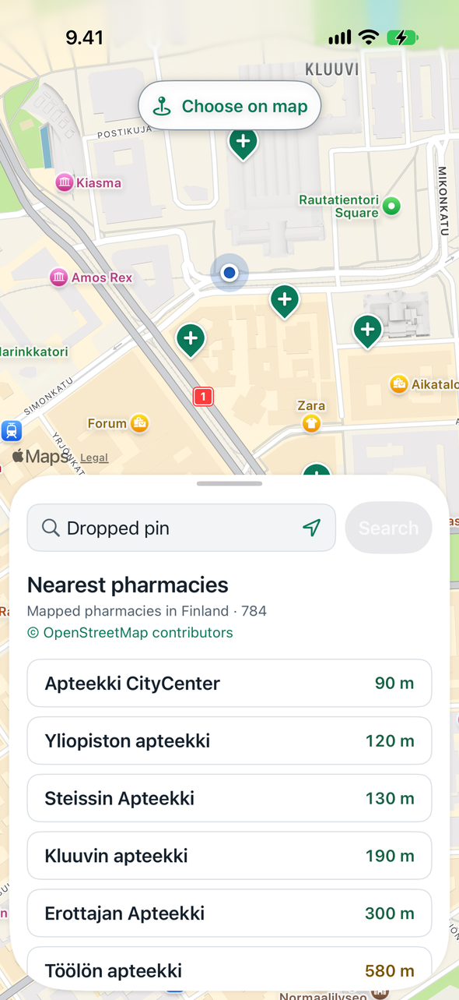

# Nearby Pharmacies · iOS

Find the nearest pharmacies in Finland from where you are, a searched address or any point on the
map. A native SwiftUI app with MapKit, Core Location and a native results sheet. It shares its
pharmacy data, ranking rules and design spec with the React web app in the companion repository
`nearby-pharmacies-web`, which also holds the data importer and the architecture decision records.



**On first launch** the app shows the 20 pharmacies nearest to Helsinki Central Railway Station,
labelled as the default starting point, and only then offers to use your location.

**Select a row or a pin** and both highlight. The map frames your starting point and the
pharmacy with a dashed straight line above the sheet, and the sheet shows the address and the
opening hours for the week.

**Change the starting point** by searching a city or street address, by using your location,
or with **Choose on map** and **Search from here** (or touch and hold the map). A fix or a chosen
point is labelled with the nearest street address, for example "Near Kaivokatu 8", from data
bundled in the app.

**The sheet** has three heights, like Apple Maps: closed (just the search field, or the selected
pharmacy), half open and full.

The app follows the device language, Finnish or English, and supports Dynamic Type up to the
accessibility sizes, VoiceOver and dark mode.

<br clear="right">

| Nearest pharmacies                          | Details and opening hours                         | A point chosen on the map                        |
| ------------------------------------------- | ------------------------------------------------- | ------------------------------------------------ |
|    |      |  |

## Run it

Requirements: Xcode 16 or later with an iOS 18 or later simulator. The project was built with
Xcode 27.2. There are no remote package dependencies, accounts or API keys.

1. Open `NearbyPharmacies.xcodeproj`, choose the `NearbyPharmacies` scheme and an iPhone
   simulator, and press Run.
2. To try location, set a simulated location in the simulator (for example Tampere,
   61.4983, 23.7732) and choose "Use my location". Tullintorin apteekki comes first.
3. To try Finnish, run with the scheme's App Language set to Finnish, or change the simulator
   language.

Signing: simulator builds need no team. To run on a device, copy
`Config/Local.xcconfig.example` to `Config/Local.xcconfig` (ignored by Git) and set your own
`DEVELOPMENT_TEAM` there rather than in Xcode's Signing & Capabilities tab, which would write it
into the project file.

From the command line, with a simulator UDID from `xcrun simctl list devices available`:

```sh
xcodebuild build -project NearbyPharmacies.xcodeproj -scheme NearbyPharmacies -destination 'platform=iOS Simulator,id=SIMULATOR_UDID' -derivedDataPath .build/DerivedData
xcrun simctl install SIMULATOR_UDID .build/DerivedData/Build/Products/Debug-iphonesimulator/NearbyPharmacies.app
xcrun simctl launch SIMULATOR_UDID fi.example.NearbyPharmacies -AppleLanguages '(fi)' -AppleLocale fi_FI
```

## What I decided and why

The reasoning is shared with the web app and described in more detail in its README and ADRs.
In short:

- **Finland, bundled.** The app ships the same dated OpenStreetMap snapshot as the web app (784
  pharmacies), so results are instant, reproducible and work offline, and ranking never sends a
  location anywhere. Outside Finland and near a land border a notice says that other countries'
  pharmacies are not included.
- **Straight-line distance, labelled as such.** Haversine with the mean Earth radius 6,371,008.8
  m, sorted by the unrounded distance with exact ties broken by OSM ID, and rounded only for
  display. The same shared fixture is checked by both apps' tests, so both rank and label every
  case identically. Walking routes are a later step.
- **Open services, on request only.** Address search uses public Nominatim with only the
  submitted text, at most one request a second and no autocomplete. If it fails or finds nothing,
  4,675 bundled Finnish and Swedish place names answer instead. The "Near …" labels come from a
  bundled OSM address index (about 9.5 MB), so neither a location fix nor a chosen point is sent
  to a geocoder. I chose not to use Apple's geocoder: in the comparison it placed a Helsinki
  address 1.9 km off and returned a single guess for an ambiguous street.
- **Native where it matters.** MapKit, Core Location (When In Use, requested only after the user
  accepts the offer, with a 10 second timeout) and a native sheet with detents rather than a
  port of the web drawer. A late location fix or search reply never overrides a point the user
  chose in the meantime.
- **Logic in a package.** Ranking, distance formatting, the `opening_hours` interpreter, the
  address index and data loading live in the local Swift package `Packages/PharmacyCore`, which
  is tested on the Mac without a simulator.

## Project layout

| Path                         | Contents                                                                                     |
| ---------------------------- | -------------------------------------------------------------------------------------------- |
| `NearbyPharmacies/`          | The app: `PharmacyFinder` (origin, results, selection), `OriginController` (search, location, map picks), the views and `Theme` design tokens |
| `NearbyPharmacies/Resources/`| Data synced from the web repository: snapshot, place names, coverage, manifest, address index |
| `Packages/PharmacyCore/`     | Ranking, formatting, opening hours, address index and data loading                           |
| `NearbyPharmaciesTests/`     | Swift Testing unit tests for the app                                                         |
| `NearbyPharmaciesUITests/`   | XCUITest journeys                                                                            |
| `docs/design/design-spec.md` | The design spec shared with the web app                                                      |

The data files are generated by the web repository's importer and copied with
`pnpm run data:sync-ios`; a checksum verification keeps both copies identical.

## Tests

```sh
swift test --package-path Packages/PharmacyCore
```

57 tests on the Mac: the shared ranking fixture, all 19 display-rounding cases, exact ties, the
bundled data against its manifest's counts and SHA-256 checksums, the web app's opening-hours
cases, geocoder requests and replies, coverage notices and the address index.

```sh
xcodebuild test -project NearbyPharmacies.xcodeproj -scheme NearbyPharmacies -destination 'platform=iOS Simulator,id=SIMULATOR_UDID' -derivedDataPath .build/DerivedData
```

Runs the app's unit tests and 17 XCUITest journeys (about three minutes): both languages, row
and pin selection, missing address and hours, the sheet states, Accessibility XXXL text, a
granted Tampere location, denial and timeout, ambiguous address matches, an empty reply, the
bundled place fallback, a map pick that wins over a late reply and a starting point across the
Swedish border. The UI tests launch with scripted location and geocoder answers, so they never
contact a live service. [AGENTS.md](AGENTS.md) has the commands for running parts of the suite.

Style: `scripts/style.sh check` runs swift-format on changed files.

## Known limitations

- Distances are straight lines, not walking routes.
- Street-address search needs the network; offline, only place names are found.
- Opening hours ignore public holidays, and there is no "open now" badge yet.
- `NominatimGeocoder.contactURL` should be set to the public repository URL, so the User-Agent
  identifies the app as the Nominatim usage policy asks.

## What I would do next

- Walking routes, or as a first step a link that opens the selected pharmacy in Maps with
  walking directions.
- A small shared backend to remove the logic that is now written in both Swift and TypeScript
  and held together by shared fixtures. I scoped it out for this version.
- A setting that turns off the online geocoder, and remembering the last starting point.

## How I built it

Both apps were built with AI coding agents (Claude Code and Codex) orchestrated in T3 Code,
following a plan, task list, design spec and fixtures I wrote first, with style hooks and tests
so the agents could verify their own work. The web app came first; this app was built against
the same spec, data and fixtures, using the reviewed web screens as the visual reference. The web
repository's README describes the process in more detail.

## Data licence

Pharmacy, place, boundary and address data © OpenStreetMap contributors, available under the
[Open Database License](https://www.openstreetmap.org/copyright). The derived files are published
under the same licence; see `NearbyPharmacies/Resources/Data/ODbL-NOTICE.txt`. The map is Apple
Maps.
