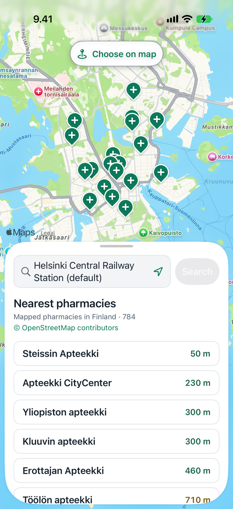

# Nearby Pharmacies · iOS

Find the 20 closest mapped pharmacies to a starting point in Finland. The SwiftUI app opens at
**Helsinki Central Railway Station** and ranks results by straight-line distance. Select a row or
map pin to see the address and weekly opening hours.

| Results | Pharmacy details | Map pick |
| --- | --- | --- |
|  |  |  |

[Watch the app journey](docs/images/journey.gif)

## Run locally

Use Xcode 16 or later with an iOS 18 or later simulator. Open `NearbyPharmacies.xcodeproj`, select
the **NearbyPharmacies** scheme and an iPhone simulator, then press Run. The project uses a local
Swift package and needs no account or API key.

Search for a city or street address, choose **Use my location**, or choose a point on the map.
The results sheet has three heights. The app supports Finnish and English, VoiceOver, Dynamic
Type, and dark mode. To try device location in the simulator, set a custom location of
`61.4983, 23.7732` (Tampere). Tullintorin apteekki appears first.

For a physical device, copy `Config/Local.xcconfig.example` to `Config/Local.xcconfig` and set
`DEVELOPMENT_TEAM` in that local file.

## Data and services

- **Ranking runs locally.** The app shares its OpenStreetMap snapshot,
  straight-line ranking rules, and test fixture with `nearby-pharmacies-web`, which owns the
  importer and data sync.
- **Address search** sends submitted text, language, and country filter to Nominatim by default.
  Bundled Finnish and Swedish place names provide a fallback. The app requests foreground
  location after the user opts in.
- **MapKit** provides the basemap and the app draws its own pharmacy results. The
  [design spec](docs/design/design-spec.md) documents interactions shared with the web app.

## Repository

| Path | Contents |
| --- | --- |
| `NearbyPharmacies/App/` | SwiftUI entry point, map and sheet coordination, finder state |
| `NearbyPharmacies/{Origin,Map,Results}/` | Origin search and location, map and pins, results sheet and details |
| `NearbyPharmacies/{Shared,Resources}/` | Theme and localization code, bundled data and configuration |
| `Packages/PharmacyCore/` | Ranking, data loading, formatting and search logic |
| `NearbyPharmaciesTests/`, `NearbyPharmaciesUITests/` | App unit tests and simulator journeys |

## Checks

Run the package tests and style check from the repository root.

```sh
swift test --package-path Packages/PharmacyCore
scripts/style.sh check --all
```

Run the app and UI tests with **Product → Test** in Xcode on an iPhone simulator. UI tests use
scripted geocoding and location. See [AGENTS.md](AGENTS.md) for command-line testing and data sync.

## Limitations

- Distances are straight lines. Street-address search requires a network connection.
- Address and opening-hours availability depend on the snapshot. The weekly schedule excludes
  public holidays.
- Set `NominatimGeocoder.contactURL` to the public project URL before publishing.

## Development

I used the reviewed web screens, shared design spec, and ranking fixture to build the SwiftUI
version with Claude Code and Codex in T3 Code.

## Data licence

Pharmacy, place, boundary, and address data © OpenStreetMap contributors, under the
[Open Database License](https://www.openstreetmap.org/copyright). See the
[bundled data notice](NearbyPharmacies/Resources/Data/ODbL-NOTICE.txt). The basemap is Apple Maps.
